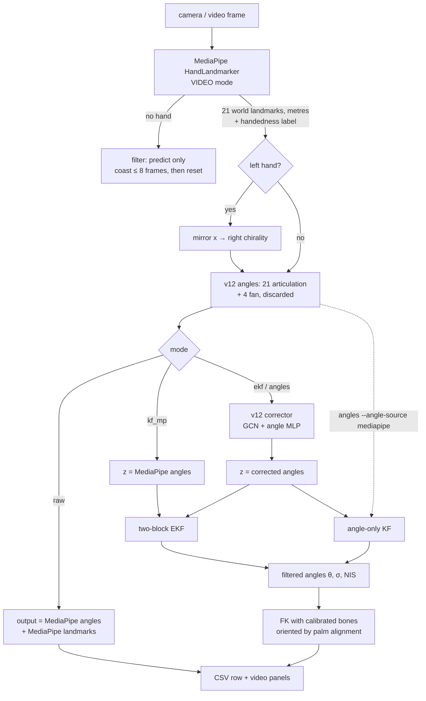

# Flow.md — how the filtering code works, and what it assumes

This is the "read me to understand the code" document. It follows one camera
frame from pixels to filtered joint angles, gives the maths for each stage,
and ends with an **assumptions log**: every assumption the code makes, where
it lives, and whether it is verified, measured, inherited or guessed.

Related: `README.md` (how to run), `../PROJECT_CONTEXT.md` (project history).

---

## 1 · The four ways to run it

Every runner calls `core/pipeline.py::run(mode)`. The pipeline is identical
across modes. Only the box marked **filter** changes, so benchmark differences
come from the method, not from plumbing.

| script | mode | angles fed to the filter | filter | 3D shown |
|---|---|---|---|---|
| `benchmarks/run_raw_mediapipe.py` | `raw` | – | none | MediaPipe's own landmarks |
| `benchmarks/run_kf_mediapipe.py` | `kf_mp` | raw MediaPipe | two-block EKF | FK of filtered angles |
| `run_ekf_corrected.py` | `ekf` | v12-corrected | two-block EKF | FK of filtered angles |
| `run_angle_kf.py` | `angles` | corrected (or raw with `--angle-source mediapipe`) | **angle-only KF** | FK of filtered angles |

### Live side-by-side comparisons (`live/`, engine `core/live_compare.py`)

These open the webcam and show **two methods at once** on the same frames:

| script | LEFT feed | RIGHT feed | isolates |
|---|---|---|---|
| `live/compare_filter_on_off.py` | corrected angles, no filter | corrected angles + angle-only KF | the filter |
| `live/compare_3d_vs_angles.py` | corrected + angle-only KF | corrected + EKF with MediaPipe 3D | the 3D-keypoint block |
| `live/compare_mediapipe_vs_corrector.py` | MediaPipe + KF | v12 corrector + KF | the corrector |

Per frame: MediaPipe runs **once**, angles are computed once, and the
corrector runs once if either side needs it. Each side then has its own
filter (one per hand) and its own 180-frame history. Both sides draw the hand
the same way (FK with your calibrated bones, turned to the palm MediaPipe
sees), including the unfiltered side, so visual differences come from the
angles only.

Live readouts: `rolling jitter` = RMS second difference over the latest
unbroken run of up to 60 frames, averaged over the 21 angles; `×raw` divides
by the same number for raw MediaPipe; `filter cost` is that side's
filter + FK time; the camera panel breaks each frame into MediaPipe /
angles + corrector / filters + drawing.

## 2 · Who imports whom

```
run_*.py ──► core/pipeline.py ──┬─► core/hand_angles_v2.py ──► core/anatomical_angles_v12.py
                                ├─► core/hand_ekf.py   (HandEKF, PersonalizedHandModel)
                                ├─► core/angle_kf.py   (AngleKF)   ──► hand_ekf (shared maths)
                                ├─► mediapipe          (HandLandmarker, models/hand_landmarker.task)
                                └─► torch              (corrector, models/angle_corrector_v12.pth)
benchmarks/compare_runs.py ─────► core/hand_angles_v2.py   (reads the CSVs only)
tests/selftest.py ──────────────► everything in core/, synthetic data only
```

`anatomical_angles_v12.py` holds **all** the angle maths. Nothing else
redefines an angle. `hand_ekf.py` builds FK from v12's own `compose()` and
checks it against `forward_kinematics_v12` each time a hand model is created.

## 3 · One frame, end to end



### Step table

| # | step | code | in → out |
|---|---|---|---|
| 1 | read frame, compute `dt` | `pipeline.run` | webcam: wall-clock since last frame; video: `1/fps` |
| 2 | detect | `HandTracker.detect` | RGB → 21×3 world landmarks (m), 21×2 pixels, label |
| 3 | chirality | `pipeline.run` | left hand: `x → −x` |
| 4 | angles | `HA.compute_angles` | 21×3 → 21 angles (deg) |
| 5 | correct (ekf, angles) | `AngleCorrector.__call__` | angles + landmarks → 21 corrected angles |
| 6 | filter | `HandEKF.step` / `AngleKF.step` | z, keypoints (mm), dt → θ, σ, NIS |
| 7 | skeleton | `.skeleton(model=calibration)` | θ → 21×3 mm, wrist at origin |
| 8 | log | CSV writer, `cv2.VideoWriter` | one row + one video frame |

---

## 4 · Each stage in detail

### 4.1 Capture and time step
* **Video file:** `dt = 1/fps` from the file header, `t = frame/fps`.
* **Webcam:** `dt` is real time between processed frames, so slow processing
  shows up as a larger `dt` and the filter predicts further ahead. The image
  is mirrored by default (selfie view).
* MediaPipe's VIDEO mode needs strictly increasing integer millisecond
  timestamps. The tracker enforces `ts ≥ last + 1`.

### 4.2 MediaPipe
`HandLandmarker` with `num_hands=1` and confidence 0.3 (detection, presence
and tracking). It returns:
* `hand_world_landmarks`: 21 points in **metres**, origin near the hand's
  centre, image-aligned axes (+x right, +y down, +z away from the camera; see A1).
* `hand_landmarks`: normalised pixels, used only for drawing.
* `handedness`: "Left" / "Right". `--hand right|left` overrides it.

### 4.3 Chirality
The corrector was trained on right hands (`ckpt['config']['hand']`), and the
v12 palm normal is signed by chirality. Left hands are mirrored once, by
negating x, right after detection.

`pipeline.resolve_hand` separates two things that are easy to mix up:
* **geometric** hand = what the landmarks look like, i.e. MediaPipe's label
  for the image *as given*. Decides the x-mirror.
* **physical** hand = the hand you are holding up. Decides which calibration
  and which filter. With the selfie flip on (webcam default), geometric and
  physical are opposite. `--hand` names the physical hand. Everything downstream is right-handed.
The drawn skeleton is mirrored back so it matches the real hand. The left
calibration file is already stored mirrored (`mirrored_to_right: true`).

### 4.4 v12 angles (`anatomical_angles_v12.py`)
At every joint there is a local frame, columns `[x̂, ŷ, ẑ]`: `ŷ` = parent
bone, `ẑ` = palm normal, `x̂ = ŷ × ẑ` (radial). With `p̂` the child bone's
unit direction:

```
abd  = arcsin(p̂·x̂)            signed, + = towards the thumb
flex = atan2(p̂·ẑ, p̂·ŷ)        signed, + = towards the palm, full ±180°
child frame = parent frame · Mx(flex) · Mz(abd)
```

That gives 21 articulation angles (4 per long finger, 5 for the thumb). The
4 fan angles (the metacarpal spread) are computed as well. They are not
filtered, because they come from calibration.

### 4.5 Corrector (`AngleCorrector`, modes `ekf` and `angles`)
* Angle branch: `[z-score | sin | cos]` of the 21 MediaPipe angles (63-dim).
* Graph branch: landmarks wrist-centred and divided by the Middle MCP→PIP
  length (bone index 9, **not** 11), plus a finger one-hot, run through a
  3-layer GCN.
* Output: `corrected = mediapipe + delta`. It is a residual model.
* It receives MediaPipe's **own** coordinate frame (see A2).

### 4.6 The process model shared by both filters

Each angle has state `s = [θ, θ̇, θ̈]` (deg, deg/s, deg/s²). Jerk is treated
as continuous white noise with power spectral density `q` (`--jerk-psd`,
deg²/s⁵):

```
F(dt) = | 1  dt  dt²/2 |          Q(dt) = q · | dt⁵/20  dt⁴/8  dt³/6 |
        | 0   1   dt   |                      | dt⁴/8   dt³/3  dt²/2 |
        | 0   0    1   |                      | dt³/6   dt²/2  dt    |
```

The only random input is jerk, so a small `q` means "explain the data with as
little jerk as possible". This is the **causal** (real-time) counterpart of
minimum-jerk smoothing. It is a jerk *prior*, not an offline minimum-jerk
trajectory optimisation (that would be an RTS smoother run afterwards, not
built).

**Adaptive `q`** (on by default since 2026-09-28): each angle's `q` is scaled by
`clip((|θ̇| / adapt_ref_speed)², 0.02, 8)`, from its own smoothed speed — the
1-euro-filter idea applied to Q. A resting finger is smoothed ~50× harder than
the fixed setting; a fast one up to 8× looser. Measured on clip.mp4 **at
matched fidelity to the input**: ~6 % less jitter than the equivalent fixed
`q`; against the previous fixed default, jitter 2.46 → 2.30 and resting jitter
0.254 → 0.212, costing +0.8° deviation and one frame of lag. Neutral on DexYCB
accuracy (13.87° vs 13.86°), since those sequences are almost always moving.
`--no-adaptive` restores fixed `q`.

Trade-off: smaller `q` gives less jitter but more lag and more **overshoot**
on sudden starts and stops, because a constant-acceleration model keeps
moving for a frame or two after the finger stops.

### 4.7 The angle-only KF (`core/angle_kf.py`, `run_angle_kf.py`)

What "joint-angle minimisation" means in this code: the filter only ever sees
the 21 angles. 3D keypoints never change the estimate.

Per frame, for each angle `i` independently:

```
predict   s ← F s
          P ← F P Fᵀ + Q
update    y = wrap(z_i − θ_i)                 innovation, wrapped to (−180, 180]
          S = P₀₀ + r_i                       r_i = σ_i² · r_scale_angles
          K = P[:,0] / S                      3-vector gain
          s ← s + K y
          P ← P − K P[0,:]
          θ_i ← wrap(θ_i)
NIS       Σ_i y_i² / S_i                      → should average ≈ 21
```

**Why 21 small filters are enough.** In the 63-state `HandEKF` with block 2
off, `H = [I 0 0]`, R is diagonal, Q does not couple angles, and the initial P
is diagonal. So P never picks up cross-angle terms, and the big filter *is*
21 independent 3-state filters. `tests/selftest.py` confirms the two agree to
**1.1e-13°**, and the small version costs **0.11 ms** per frame against 0.31 ms
(same estimate) and 6.0 ms for the full two-block EKF.

The calibrated hand model is used only to **draw** θ. Its orientation comes
from a palm-only Umeyama fit to MediaPipe's landmarks, which is also display
only.

### 4.8 The two-block EKF (`core/hand_ekf.py`, modes `kf_mp` and `ekf`)
Same process model, but one 63-state vector, with two measurement updates per
frame applied one after the other.

**Block 1 (angles).** Linear, `H₁ = [I 0 0]`, `R₁ = diag(σ²)·r_scale_angles`,
wrapped innovation. Mathematically the same as 4.7.

**Block 2 (3D keypoints).** Nonlinear:
1. `p, J = FK(θ)`: calibrated bones and fan, flat palm, wrist at origin, mm.
   `J` is the analytic geometric Jacobian, `∂p_k/∂θ_j = â_j × (p_k − p_j)`
   times π/180, because the state is in degrees.
2. **Palm alignment.** Umeyama similarity (s, R, t) from FK's wrist + 5 MCPs
   to MediaPipe's. Those 6 FK points do not depend on θ, so the Jacobian stays
   exact. The scale is smoothed with an EMA (`0.05`).
3. Measure the **15 finger keypoints** only: `r = z − (s R p + t)` (45-dim),
   `H₂ = s·R·J`.
4. `R₂ = diag(σ_xy², σ_xy², σ_z²)·r_scale_kps per keypoint + C_align`.
   `C_align` is the covariance of the error the alignment itself introduces:
   palm noise perturbs the fitted rotation ω and translation τ, which moves a
   finger point at lever `y_k` by `−[y_k]× ω + τ`. Every fingertip shares
   that, so `C_align` is a full 45×45 block.
5. Standard EKF update, `NIS₂ = rᵀ S⁻¹ r` (target ≈ 45).

### 4.9 Track management (both filters)
* **Initialise** on the first measurement: θ = z, velocity = acceleration = 0,
  `P = diag(10², 200², 2000²)` per angle.
* **Dropout:** predict only, for up to `--max-coast` = 8 frames, then reset.
* **Two hands:** one filter per hand. A filter left idle for more than 8
  frames while the other hand was tracked is reset before reuse.
* **Reset key** `r` clears both.

### 4.10 Outputs
* CSV per frame: `mp_*`, `out_*` (and `corr_*`, `std_*`) angles;
  `kpmp_*`, `kpout_*` keypoints (mm, wrist-centred, **right chirality**,
  MediaPipe axes); `nis1`, `nis2`, `resid_mm`, `scale`, `coasting`, `block2`.
* Video: camera with landmarks | front view | side view.

### 4.11 Benchmarks (`benchmarks/compare_runs.py`)
There is no ground truth for your own footage, so these measure
**smoothness, consistency and lag, not accuracy**:

| metric | definition |
|---|---|
| `ang_jitter` | RMS second difference of angles (deg/frame²), unwrapped, only within unbroken detection runs |
| `ang_jerk` | RMS third difference |
| `kp_jitter_local_mm` | RMS second difference of 3D keypoints in each frame's own palm frame (articulation only) |
| `kp_jitter_mm` | same, camera orientation (includes root rotation noise) |
| `bone_cv_pct` | bone-length std/mean over time, mean of 20 bones |
| `dev_mp_deg` / `dev_corr_deg` | mean \|output − raw MediaPipe\| / \|output − corrected\| |
| `lag_frames` | median cross-correlation peak between output and raw MediaPipe |
| `nis1`, `nis2` | mean normalised innovation squared |

Lower jitter is only better up to a point: a filter that ignores the data
has zero jitter. Always read jitter next to `dev_*` and `lag_frames`.

---

## 5 · Assumptions log

Status key: **verified** (tested in this code) · **measured** (a number
observed on real data) · **inherited** (from PROJECT_CONTEXT, not re-checked
here) · **guessed** (a default to replace) · **known false** (in use anyway,
with a mitigation).

### Input and geometry

| # | assumption | where | status | if wrong |
|---|---|---|---|---|
| A1 | MediaPipe and FreiHAND share the 21-keypoint order; world landmarks are in metres with image-aligned axes: x right, y down, **z away from the camera** (right-handed, same chirality as an OpenCV camera frame; §4.2's "+z toward the camera" was wrong, corrected 2026-10-03 from the MediaPipe docs and the FreiHAND abduction-sign check). Angles are unaffected; the Unity stream depends on it | `HandTracker`, `to_view`, `unity_stream.py` | inherited | every angle is wrong |
| A2 | The corrector was trained on landmarks in MediaPipe's native world frame (not rotated to y-up) | `AngleCorrector` | **verified 2026-10-03** against `freihand_angle_correction_v12 (2).ipynb`: `norm_landmarks` only wrist-centres and divides by kp 9→10, with no rotation | the GCN branch sees rotated input and the correction degrades |
| A3 | The corrector's input encoding (`clip(−180,360)`, z-score/sin/cos, bone-9 scaling) matches training | `AngleCorrector._encode/_nodes` | inherited (copied from `hand_recon_common.py`) | silent degradation |
| A4 | Negating x turns a left hand into a valid right hand for angles, corrector and calibration | pipeline step 3 | inherited | abduction signs flip on left hands |
| A5 | MediaPipe's label follows the image **as given**, so a flipped (selfie) image reports the opposite of the physical hand | `resolve_hand` | **verified on clip.mp4** (unmirrored: right→"right", left→"left"). The mirrored case is **inferred** from that, not seen | if wrong, the webcam run uses the other hand's calibration (~3 % bones) and filter. Check the HUD's hand label once; `--hand` overrides |
| A6 | Only one hand is in frame (`num_hands=1`) | `HandTracker` | design choice | the second hand is ignored |
| A7 | Fan angles are constant for a subject, so they come from calibration, not the filter | `PersonalizedHandModel` | inherited (GT std < 1° for 3 of 4) | palm spread errors go into block 2 |
| A8 | Calibrated bone lengths and palm fan describe the subject | `calib/*.json` | measured (§16) | FK skeleton is off |

### Filter model

| # | assumption | where | status | if wrong |
|---|---|---|---|---|
| A9 | Angles move smoothly: constant acceleration driven by white jerk | `cwnj_F/Q` | modelling choice | lag and overshoot on fast motion (visible in the plots) |
| A10 | The same jerk PSD `q = 1e5` suits all 21 angles | `EKFConfig.jerk_psd` | **guessed** (1e4 lagged badly on synthetic 0.2–0.8 Hz motion) | a thumb CMC and a DIP really move differently; tune per angle |
| A11 | Angle noise is white, Gaussian, zero-mean, σ = 6°, equal for all angles | `EKFConfig.sigma_angle` | **guessed**, then checked on DexYCB. **Measured on a still fist: 0.58°** (MediaPipe) / 0.36° (corrected) — MediaPipe's video mode smooths landmarks, so still-hand jitter far understates the real error | NIS₁ off target. MediaPipe error is partly a **bias that persists over frames**, which no KF removes. `calibration/measure_still_noise.py` gives the per-angle shape; the level comes from DexYCB |
| A12 | Angle noise is independent across angles (diagonal R₁) | both filters | **known false** (PIP/DIP share keypoint 7) | slightly overconfident σ. This is what makes the angle-only KF decouple |
| A13 | `r_scale_angles = 2` makes up for unmodelled correlation | `EKFConfig` | guessed | a variance multiplier, tune by NIS |
| A14 | The corrector's output is unbiased | both filters | **known false** (v12 test MAE ~23° vs GT) | the filter gives a smooth, confident, biased answer (§15.4) |
| A15 | Keypoint noise is Gaussian, independent per keypoint, axis-aligned with σ_xy = 6, σ_z = 25 mm in MediaPipe's world frame | `EKFConfig` | **guessed**. Measure by Procrustes on the FreiHAND NPZ | block 2 over- or under-trusted |
| A16 | Block-1 and block-2 errors are independent | `HandEKF.step` | **known false** (corrected angles come from the same keypoints) | P shrinks too fast; `r_scale_*` is the hedge |
| A17 | The FK model (flat palm, hinge PIP/DIP/IP, no thumb twist) can represent the observed hand | `PersonalizedHandModel.fk` | **known false**: ~13 mm floor with MediaPipe's own bones | a residual no tuning removes |
| A18 | MediaPipe's skeleton proportions match the calibration | block 2 | **measured false**: wrist→MCP +38–48 %, distal +34–60 %, ~26 mm floor | block 2 pulls angles off (bias). `--kp-model mediapipe` mitigates |
| A19 | Wrist + 5 MCPs are unaffected by articulation angles | `PALM_IDS` | **verified** (FK construction; Jacobian rows zero) | – |
| A20 | Alignment error is small-angle and linear, from unweighted least squares | `_alignment_cov` | **verified** synthetic: NIS₂ 46.8 vs target 45 | block 2 over-trusted on large palm noise |
| A21 | Hand scale changes slowly (EMA 0.05) | `HandEKF.align` | guessed | brief scale mismatch after big depth moves |
| A22 | Linearising FK at the predicted θ is good enough (one EKF iteration) | `update_keypoints` | inherited (Jacobian exact at the point) | very fast motion could need an iterated EKF |

### Tracking and time

| # | assumption | where | status | if wrong |
|---|---|---|---|---|
| A23 | Gaps ≤ 8 frames are better bridged by prediction than by resetting | `max_coast_frames` | inherited (§15.1: rejecting helps ≤ 5, hurts > 8) | drift during long gaps |
| A24 | Video files have no dropped frames (`dt = 1/fps`) | pipeline | assumed | wrong `dt` → wrong velocity |
| A25 | Webcam `dt` = wall-clock between processed frames | pipeline | design choice | processing hiccups look like motion pauses |
| A26 | The initial std (10°, 200°/s, 2000°/s²) is loose enough | `EKFConfig.init_std` | guessed | affects only the first ~10 frames |
| A27 | Keeping θ wrapped to (−180, 180] is harmless | both filters | verified (wrap test, max step 0.55°) | – |

### Evaluation

| # | assumption | where | status | if wrong |
|---|---|---|---|---|
| A28 | Smoothness and consistency are useful proxies when no GT exists | `compare_runs.py` | limitation | over-smoothing scores well. Read `dev_*` and `lag` |
| A29 | Synthetic tests reflect real behaviour | `selftest.py` | **optimistic**: FK-generated hands, known noise, no bias, no structural floor | real NIS and RMSE are worse |
| A30 | The drawn skeleton's orientation is a per-frame palm fit, so it carries raw MediaPipe noise. **Since 2026-09-28 it is exponentially smoothed for display** (`root_tau_s`, default 0.08 s), while block 2 still uses the raw fit | `RootSmoother`, `.skeleton()` | **measured**: camera-frame `kp_jitter_mm` 20.5 → 13.8 (τ=0.08) → 12.0 (τ=0.15) on clip.mp4, with the angle estimate and NIS unchanged. Raw MediaPipe is 17.4, so the unsmoothed drawing was *shakier than raw* even though the angles were 3.5× smoother | too large a τ makes the hand's orientation lag when you rotate your wrist; the finger angles are unaffected either way |
| A31 | A 60-frame rolling jitter is a fair live summary | `live_compare.rolling_jitter` | design choice | it resets at every dropout, and fast motion raises it for every method alike. Compare the ratio, not the absolute number |
| A32 | Webcam `dt` includes processing time (~70 ms at ~14 fps here) | `live_compare`, `pipeline` | measured | at low fps the filter predicts further between frames, so it lags more than on a 30 fps video |

---

## 6 · Decisions taken, and what was rejected

| decision | alternative | why |
|---|---|---|
| Palm-only alignment + alignment covariance in R₂ | plain diagonal R₂ | synthetic: block 2 worse than raw (12–19° vs 6°), NIS₂ ≈ 210 |
| Palm-only alignment | Umeyama on all 21 points | some angle combinations look like palm rotation, become unobservable, and drift (RMSE > 90°) |
| Block 2 on 15 finger keypoints | all 21 | palm points carry no angle information; removing them removes correlation with the alignment |
| Angle-only filter as 21 × 3-state filters | reuse `HandEKF(use_block2=False)` | identical estimate (1e-13°), ~3× cheaper, easier to read |
| One filter per hand | a single filter | switching hands would drag the state across for ~10 frames |
| Default `--kp-model calib` | `mediapipe` | follows the project design; the alternative is offered and benchmarked, the choice is yours |
| Corrector fed the MediaPipe frame | y-up view frame (as in `live_hand_reconstruction.py`) | the GCN branch reads raw coordinates; see A2 |

---

## 7 · Results

### 7.1 Synthetic (tests/selftest.py; known truth, matched noise)

| variant | RMSE deg | jitter | NIS₁ | NIS₂ |
|---|---|---|---|---|
| raw measurement | 6.01 | 14.75 | | |
| angle-only KF (`angle_kf.py`) | 4.07 | 3.38 | 24.5 | |
| two-block, block 2 only | 4.99 | 3.25 | | 49.2 |
| two-block, both | **2.63** | 2.30 | 22.9 | 46.8 |

On synthetic hands, where the FK model is *exactly right*, the keypoint
block helps. On real footage it currently does not (7.2): A17 and A18.

### 7.2 Real footage — `Live_Webcam_testing/clip.mp4`

991 frames at 30 fps, 946 with a detection. The right hand is used first,
then the left from frame 548 (checked against the video). Default knobs
(`q = 1e5`, σ = 6°, `r_scale = 2`). Smoothness only, no ground truth. From
`output/benchmarks/clip/benchmark_summary.csv`.

| run | angle jitter (× raw) | jerk | 3D jitter, local mm | dev from raw MP | dev from corrected | NIS₁ | NIS₂ |
|---|---|---|---|---|---|---|---|
| raw MediaPipe | 8.70 (1.00) | 14.99 | 11.04 | 0 | – | – | – |
| corrected, unfiltered | 5.34 (0.61) | – | – | – | 0 | – | – |
| angle-only KF on **MediaPipe** angles | 4.30 (0.49) | 7.27 | 7.32 | 3.7° | – | 16.9 | – |
| two-block EKF on MediaPipe (`kf_mp`) | 4.54 (0.52) | 7.68 | 7.72 | 6.0° | – | 27.5 | 25.4 |
| two-block EKF on corrected (`ekf`) | 3.12 (0.36) | 5.25 | 6.91 | 12.3° | 5.8° | 24.1 | 30.9 |
| **angle-only KF on corrected** (`run_angle_kf.py`) | **2.42 (0.28)** | **4.00** | **5.46** | 11.7° | 2.8° | 10.1 | – |

Every column of the angle-only KF matches the earlier `ekf --no-block2`
run, which confirms the equivalence in 4.7 on real data too. Lag is 1 frame
(33 ms) for all filters.

**What this says**
1. **The angle-only KF on corrected angles is the smoothest, and it stays
   closest to its own input** (2.8° from the corrected angles, against 5.8°
   for the two-block EKF). On this footage, adding the keypoint block makes
   things worse, for the reasons in A17/A18.
2. **The corrector smooths as well as corrects.** Its unfiltered output is
   already 0.61× raw jitter. The same filter gives 0.49× on raw MediaPipe and
   0.28× on corrected angles.
3. "11.7° from raw MediaPipe" is mostly the **correction itself**, not filter
   lag: the corrected input already differs from MediaPipe by about that much.
4. The **overshoot** of the constant-jerk model is visible in
   `output/benchmarks/clip_angle_kf/benchmark_Index_PIP_Flex.png` at the fast
   flex/extend steps (t ≈ 6, 9, 15, 22 s), strongest on raw MediaPipe input.
5. **NIS₁ = 10 is below its target of 21**, so σ = 6° over-states the noise.
   The filter trusts the corrector less than it could.

### 7.3 Offline tuning sweep — angle-only KF on the clip's corrected angles

The saved `corr_*` angles were re-filtered offline, with the same per-hand
reset logic. At the defaults this reproduces the pipeline run exactly.

| σ (deg) | q | jitter | dev from corrected | lag | NIS₁ |
|---|---|---|---|---|---|
| 3 | 3e4 | 2.57 | 2.75 | 1 | 38.9 |
| 3 | 1e5 | 2.69 | 2.21 | 1 | 29.2 |
| 3 | 3e5 | 2.82 | 1.77 | 1 | **22.3** |
| 4 | 3e4 | 2.46 | 3.03 | 1 | **24.8** |
| 4 | 1e5 | 2.59 | 2.46 | 1 | **18.9** |
| 4 | 3e5 | 2.70 | 2.00 | 1 | 14.5 |
| 6 (default) | 3e4 | 2.29 | 3.45 | 2 | 13.1 |
| 6 (default) | 1e5 | 2.42 | 2.85 | 1 | 10.2 |
| 6 (default) | 3e5 | 2.53 | 2.35 | 1 | 7.9 |

Jitter barely moves across this grid (2.3–2.8, all about 0.3× raw), while
fidelity to the input and NIS change a lot. **σ ≈ 4°, q ≈ 1e5** is
NIS-consistent and costs almost nothing in smoothness:
`python run_angle_kf.py --sigma-angle 4`. Caveat: NIS ≈ 21 assumes errors are
white in time. MediaPipe and corrector errors are partly persistent (A11), so
treat NIS as a guide, not a proof.

**Speed** (CPU, after the FK speed-up: the metacarpal and palm frames are
precomputed and the Jacobian vectorised, and the self-test still matches to
2e-8). MediaPipe ~35–40 ms · v12 angles ~3.6 ms · corrector ~0.7 ms ·
angle-only KF 0.2 ms · two-block EKF 4.5 ms · FK 0.36 ms. The live
comparison scripts run at ~14 fps on the 1280×720 clip, limited by
MediaPipe. Downscaling the input before detection did not make MediaPipe
faster.

---

### 7.4 Accuracy against ground truth — `validation/validate_dexycb.py`

7.1–7.3 measure smoothness. DexYCB (30 fps RGB, per-frame 3D joints in the
same 21-joint order) measures **error**. Flow per sequence:

1. Read `meta.yml` (hand side, frame count) and `labels_*.npz` (`joint_3d`,
   metres, all −1 = no hand).
2. Run MediaPipe in VIDEO mode on `color_*.jpg`, with a fresh tracker per
   sequence, and cache the result to `mp_cache/<sequence>.npz`.
3. Mirror left hands into right chirality, using the **ground-truth** side;
   MediaPipe's label agreement is reported separately.
4. Ground-truth angles = v12 angles of the ground-truth joints. MediaPipe and
   corrected angles are computed as in the live pipeline.
5. Hand model = median bones + fan from that sequence's own ground truth
   (**oracle calibration**; `--calib mediapipe` for the realistic case).
6. Run the six methods with a fresh filter per sequence and `dt = 1/30`.
7. Score on frames where the ground truth exists **and** MediaPipe detected
   the hand (the same frames for every method):
   * angle MAE / RMSE / median / PCK@10°, wrap-aware;
   * per-angle signed **bias** (what filtering cannot fix);
   * PA-MPJPE (similarity-aligned 3D joint error). `mp` uses its own
     landmarks, the rest FK of their angles, next to the FK model floor;
   * acceleration error, jitter relative to the ground truth, lag against the
     ground truth;
   * `coast_mae` on frames the filters bridged without a detection.

Validation assumptions, in addition to §5: DexYCB joints are MANO joint
centres (like FreiHAND, which the corrector was trained on). Hands hold
objects, so there is more occlusion than on a webcam. The cameras view a
table from around it, not face-on. Sequences are short (~70–90 frames), so
filter start-up is a noticeable fraction of each sequence. On the local
fake-data test (MediaPipe + noise as "ground truth") the pipeline, left-hand
mirroring (left and right MAE match) and the notebook cells all ran. Real
numbers come from Colab.

### 7.5 Measured accuracy — DexYCB subject 01, 100 sequences (2026-09-17)

6,928 frames with GT, 5,765 of them with a MediaPipe detection (83 %), camera
`836212060125`, one right-handed subject, hands holding objects.
`output/validation/dexycb/full/`.

| method | angle MAE | PCK@10° | PA-MPJPE | accel err | jitter/GT | lag | coast MAE | NIS1 | NIS2 |
|---|---|---|---|---|---|---|---|---|---|
| MediaPipe raw | 20.67° | 31.6 % | 16.3 mm | 9.90 | 6.89 | 0 | – | – | – |
| corrector, unfiltered | 14.01° | 44.5 % | 16.3 mm | 5.36 | 3.38 | 0 | – | – | – |
| angle KF on MediaPipe | 21.10° | 31.1 % | 17.2 mm | 3.84 | 3.08 | 0 | 39.7° | 63.9 | – |
| angle KF on corrector | 14.08° | 44.2 % | 16.3 mm | 2.40 | 1.06 | 0 | 22.6° | 11.5 | – |
| EKF on MediaPipe | 20.99° | 31.3 % | 14.9 mm | 3.87 | 3.33 | 0 | 39.8° | 75.3 | 27.2 |
| **EKF on corrector** | **13.76°** | **46.4 %** | **13.2 mm** | 2.46 | 1.10 | 0 | 23.8° | 24.2 | 31.0 |

(FK model floor 8.8 mm. Oracle calibration from GT; see below for the
realistic case.)

1. **The corrector is what buys accuracy: −32 % MAE** (20.67° → 14.01°) on an
   unseen subject, unseen dataset, with object occlusion. This is the first
   accuracy number for v12 outside FreiHAND.
2. **Filtering buys smoothness, not accuracy**, exactly as §5 A14 predicts.
   MAE moves by ±0.3°, while the acceleration error halves (5.36 → 2.40) and
   jitter drops from 3.4× the GT's own to 1.06×, at **zero lag**.
3. **Filtering raw MediaPipe does not improve MAE at all** (20.67 → 21.10).
   MediaPipe's error is largely persistent, not white, so there is nothing for
   a filter to average out. Filter the corrected angles, not the raw ones.
4. **Block 2 helps here**, which contradicts what §7.2's webcam clip suggested:
   best MAE (13.76°) and much the best 3D error (13.2 mm vs 16.3 mm). The
   clip could only measure deviation and smoothness, never error -- a warning
   about drawing conclusions without ground truth. Re-running with the
   block-2 skeleton estimated from MediaPipe instead of the GT (the realistic
   live case) still beats the angle-only filter: **13.91° vs 14.08°**.
5. **Per-source noise:** NIS1 is 63.9 for MediaPipe angles but 11.5 for
   corrected ones, i.e. MediaPipe's angle noise is roughly 2-3x larger. One
   `--sigma-angle` for both sources is wrong; ~12-16° suits MediaPipe.
6. **Dropouts are expensive:** error while coasting is 22.6° (corrected) and
   39.7° (MediaPipe) against ~14 / 21 when tracked. Bridging gaps is a
   fallback, not free.
7. **MediaPipe's handedness label was wrong on 9 % of frames** (91.1 %
   agreement with DexYCB), which supports using `--hand` when you know it.

**Defaults changed on this evidence** (grid over the realistic,
MediaPipe-skeleton case): `jerk_psd` 1e5 → **3e4** and `sigma_xy` 6 → **15 mm**
(MAE 13.86°, accel 2.33, versus 13.91 / 2.45 at the old values).

⚠️ **NIS is not the final word.** The best setting has NIS2 ≈ 9.5, far below
the target of 45, i.e. formally "R too large". It still wins on MAE, because
the unmodelled FK mismatch (A17/A18) is real error that R has to absorb. Tune
by NIS only until you have ground truth; after that, tune by MAE.

## 8 · Tuning by NIS

NIS (normalised innovation squared) asks whether the surprise matches what
the filter expected:
* mean `nis1 ≈ 21` and `nis2 ≈ 45` → R and Q are consistent with the data.
* **Far below** → you assumed more noise than there is (R too big, or `q`
  too big). The filter is over-smoothing.
* **Far above** → you assumed too little. The filter is overconfident,
  or the data is biased.

Suggested order: (1) angle-only KF, tune `--sigma-angle` until `nis1 ≈ 21`
on a still-ish segment; (2) adjust `--jerk-psd` for the lag/overshoot you
accept on fast segments; (3) only then turn block 2 on and tune `σ_xy`, `σ_z`
for `nis2 ≈ 45`, after first choosing `--kp-model`.

**With ground truth, tune by MAE instead** (§7.5 showed NIS and MAE disagree
once the FK model is imperfect): `validation/tune_dexycb.py` searches
`jerk_psd`, `sigma_angle` and `σ_xy`/`σ_z` in log space — random search then
Nelder–Mead — fitting on half the sequences and reporting on the other half.
`r_scale_*` is pinned to 1 because it is degenerate with the sigmas, and the
per-angle noise shape comes from the measured signal (robust MAD of second
differences, `Var(Δ²z) = 6σ²` for white noise), not from the labels, so only a
global multiplier is fitted. It emits `tuned_flags.txt` and a per-angle sigma
CSV that the live runners accept through `--angle-noise-csv`.

## 8b · Added 2026-10-03

* **Threaded capture + MediaPipe** (`pipeline.DetectionStream`). Video: a
  4-deep blocking queue, no drops, output byte-identical to the sequential
  run. Webcam: a 1-deep latest-only queue; `t` is the capture time, so
  `dt` = real interval between the frames the filter sees (supersedes A25/A32
  for the webcam: processing time no longer inflates dt, skipped frames do).
* **Robust R** (`EKFConfig.robust`, off by default). Block 1, per angle:
  d = |y| / sqrt(P_θθ + r); r ← r · (d/k)^p when d > k. Block 2, per finger
  keypoint: d = sqrt(r_kᵀ S_kk⁻¹ r_k / 3); only that keypoint's own noise
  block is inflated (not C_align). One pass (no IRLS iteration). Synthetic
  4 % spikes: RMSE 7.49 → 4.92°, clean data 4.14 → 4.16°. DexYCB s01: k=3
  gives 13.87 → 13.85°, jitter/GT 0.98 → 0.90; tuned (k=1.5, k_kp=10 i.e.
  block 2 not gated) 13.741 → 13.593° held out at equal acceleration error.
* **Coast decay** (`EKFConfig.coast_decay` = 0.3): velocity and acceleration
  ×0.3 per coasting frame. A constant-acceleration extrapolation over up to 8
  frames ran away (frame analysis: 40 → 65° in one clip). Coast MAE 21.9 →
  18.2°, detected-frame MAE 13.87 → 13.88°.
* **Unity stream** (`unity_stream.py`): joints as displayed, metres,
  (x, −y, z) from MediaPipe axes to Unity's left-handed y-up frame.

## 9 · What is not built
* Offline RTS smoother (true two-sided minimum-jerk smoothing of a recorded clip).
* Root pose (3 rotational DOF) in the state, instead of a per-frame palm fit.
* Per-angle `q`, full 21×21 R₁, measured σ_xy/σ_z.
* Accuracy evaluation against ground-truth sequences.
